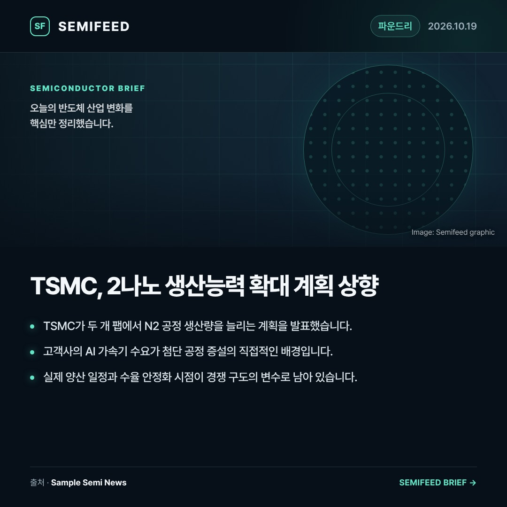

# Semifeed

반도체·전기전자 뉴스를 골라 1080×1080 카드로 만들고, Slack 승인 후 Instagram에 게시하는 파이프라인입니다.

상시 서버 없이 두 부분으로 동작합니다.

- **Claude Code 예약 작업**: RSS 수집 → Claude가 기사 선별·문구 작성 → 카드 렌더링 → `cards/`에 커밋 → Slack에 승인 요청
- **Cloudflare Worker**: Slack 버튼 콜백을 받아 `raw.githubusercontent.com`의 카드 이미지로 Instagram에 게시

Claude는 판단이 필요한 일(기사 선별, 카드 문구)만 맡고, 나머지는 `scripts/`의 스크립트가 맡습니다. 실패 지점을 분명히 하고 결과를 재현할 수 있게 하기 위해서입니다.

## 진행 상황

| 단계 | 파일 | 상태 |
| --- | --- | --- |
| 1. 수집 | `scripts/fetch.py` | 완료 |
| 2. 렌더 | `scripts/render.py` | 완료 |
| 3. Slack 전송 | `scripts/slack_post.py` | 예정 |
| 4. 승인·게시 | `worker/` | 예정 |
| 5. 예약 작업 절차 | `RUN.md` | 예정 |

기존 n8n + Google Cloud VM 구성은 `legacy/`에 보관합니다.

## 구조

```
config/semifeed.json   RSS 목록, 수집 시간 창, Slack 채널·Instagram 계정 ID
scripts/fetch.py       RSS 수집, 72시간 필터, 중복 제거 → candidates.json
scripts/mark_seen.py   카드로 만든 기사 링크를 state/seen.json에 기록
scripts/render.py      카드 JSON + templates/card.html → JPEG
state/seen.json        처리한 기사 링크 (승인 여부와 무관하게 생성 시점에 기록)
cards/<날짜>/<id>.*    카드 이미지와 메타데이터 (Worker가 raw URL로 읽음)
templates/card.html    카드 디자인 (DESIGN.md)
fonts/                 Pretendard 가변 폰트 (SIL OFL 1.1)
tests/                 fetch.py 테스트와 샘플 피드·카드
```

## 실행

```bash
# 1. 수집: candidates.json 생성 (표준 라이브러리만 사용)
python3 scripts/fetch.py

# 2. 렌더: cards/2026-10-19/<id>.json → <id>.jpg
pip install -r requirements.txt
python3 scripts/render.py cards/2026-10-19/<id>.json

# 3. 처리한 기사 기록
python3 scripts/mark_seen.py <기사 링크>...

# 테스트
python3 -m unittest discover tests
```

`render.py`는 제목·본문이 카드 영역을 넘치면 이미지를 만들지 않고 종료 코드 2로 끝냅니다. 문구를 줄여 다시 실행하라는 신호입니다.

카드 JSON 필드는 `scripts/render.py` 상단 설명과 `tests/fixtures/card_sample.json`을 참고합니다.



## 시크릿

토큰은 저장소에 커밋하지 않습니다. Slack 토큰은 예약 작업 환경 변수에, Instagram 토큰과 Slack 서명 비밀값은 Cloudflare Worker Secret에 둡니다.
